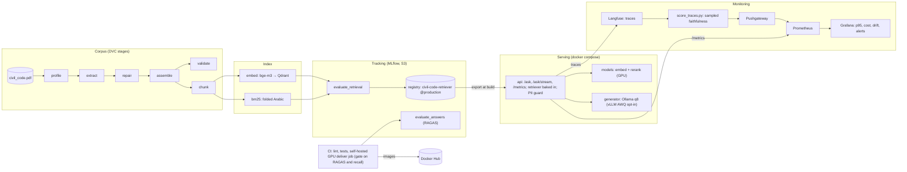
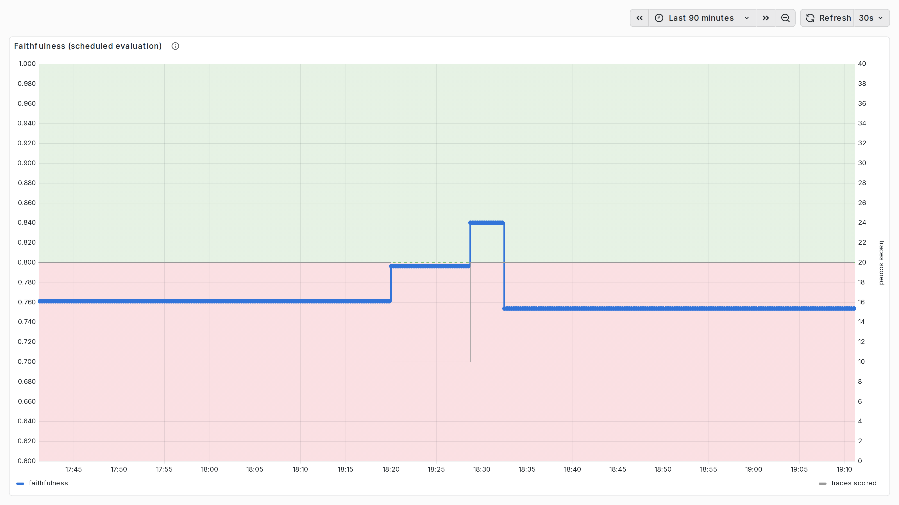
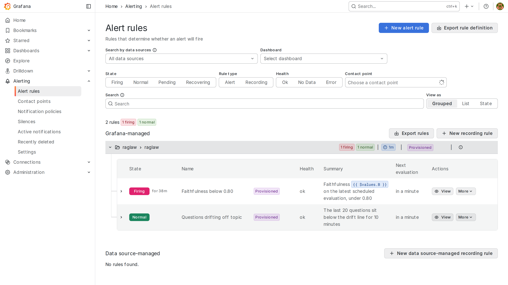
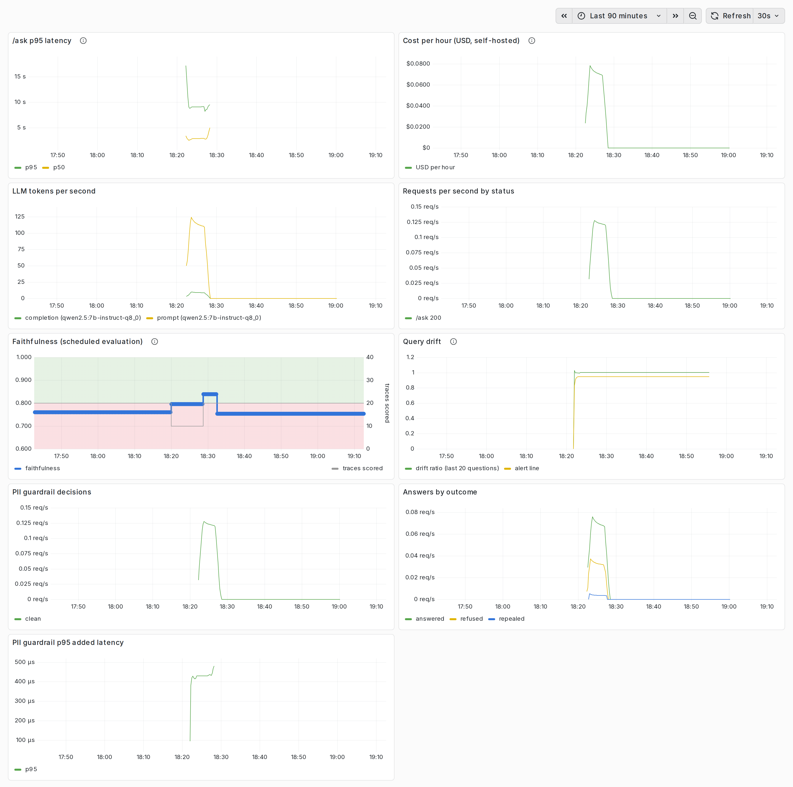
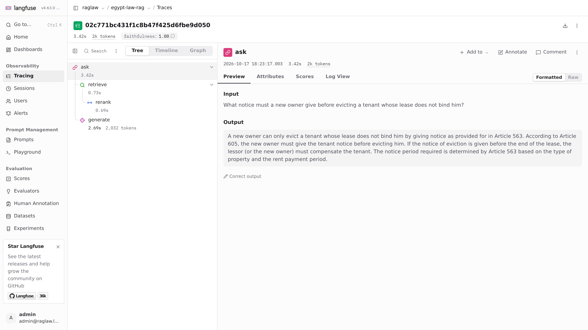
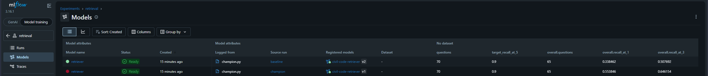
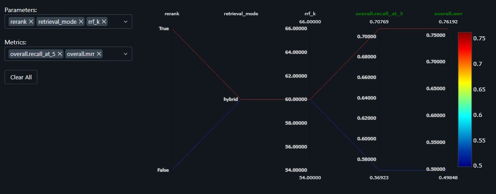

# egypt-law-rag

[](https://github.com/mooncholy/egypt-law-rag/actions/workflows/ci.yml)

A retrieval-augmented generation (RAG) chatbot that answers questions about the Egyptian Civil Code, in Arabic or English, and cites the articles it answers from.
The source is a bilingual PDF (170 pages, English and Arabic side by side). A DVC pipeline turns it into a validated corpus of articles and chunks, and a FastAPI service answers over that corpus.

It's a study project, not legal advice; read [Limitations and honesty](#limitations-and-honesty) before relying on an answer or a score.

## Quickstart

### 1. Run the service, no clone needed

All you need is Docker and about 16 GB of RAM. The images come from Docker Hub (`mooncholy/raglaw-api`, `mooncholy/raglaw-models`), with the index and the production retriever baked in, so there's no AWS account, data download or Python setup:

```bash
mkdir egypt-law-rag && cd egypt-law-rag
curl -fsSLO https://raw.githubusercontent.com/mooncholy/egypt-law-rag/main/compose.yaml
docker compose up
```

The first start downloads the two retrieval models (about 4.5 GB) and the generator (about 8 GB) into Docker volumes; later starts reuse them. `api` starts once both are ready. Then:

```bash
curl -s localhost:8000/health
curl -s localhost:8000/ask -H 'Content-Type: application/json' \
  -d '{"question": "ما هي سن الرشد في القانون المدني؟"}'
```

A real response (version 4 of the retriever, `qwen2.5:7b-instruct-q8_0`):

```json
{
  "answer": "سن الرشد في القانون المدني هو واحد وعشرون سنة ميلادية كاملة، وفقًا لـ `المادة ٤٤`.",
  "sources": ["Egyptian Civil Code, Article 44"]
}
```

A question on a repealed range is answered from the Code's repeal note, without the LLM:

```json
{
  "answer": "كانت أحكام إثبات الالتزام في القانون المدني واردة في المواد من ٣٨٩ إلى ٤١٧، وقد ألغيت. ولا يتضمن القانون المدني الحالي من هذه المواد إلا ما يفيد إلغاءها.",
  "sources": ["Egyptian Civil Code, Article 389"]
}
```

The answer can also be streamed as server-sent events: `data: {"token": ...}` per piece as the LLM writes it, then `event: sources` with the cited articles. An empty question gets a 422.

```bash
curl -N localhost:8000/ask/stream -H 'Content-Type: application/json' \
  -d '{"question": "What is the age of majority?"}'
```

| Service | Port | What |
| --- | --- | --- |
| `api` | 8000 | `/ask`, `/ask/stream`, `/health` and `/metrics`. Bakes in the index and a copy of the production retriever; redacts personal data from every answer; runs as a non-root user, without torch |
| `models` | 8001 | The embedder and reranker, on pinned revisions; weights in the `hf-cache` volume |
| `ollama` | – | The generator, pulled once into the `ollama` volume |

- **Less than about 16 GB of RAM** (a 4-core GitHub Codespace, say): run `RAGLAW_LLM_MODEL=qwen2.5:7b-instruct-q4_K_M docker compose up`. That's the same model in 4 bits, 4.7 GB instead of 8.1 GB, but it isn't measured.
- **CPU only:** the published images run on CPU, and answer slowly. To use an NVIDIA GPU, clone the repository (step 2): the GPU build of the `models` image is built from it.
- **To stop:** `docker compose down`. The volumes keep the models for the next start.

### 2. Clone and set up

To develop, run on a GPU, or rebuild the pipeline, clone the repository.

**Prerequisites**
- [uv](https://docs.astral.sh/uv/) **0.12.20**, pinned in `pyproject.toml`. uv installs Python 3.14 itself.
- For the data and the tracking store only: an AWS profile with access to the project bucket. Unit tests don't need it; they run on synthetic inputs, including a small PDF generated at test time.
- Optional: an NVIDIA GPU (a driver with CUDA 13) to embed and rerank faster.

```bash
git clone https://github.com/mooncholy/egypt-law-rag.git && cd egypt-law-rag
uv sync                      # dev, ingest, embed and CPU-only torch, from uv.lock
cp .env.example .env         # then set RAGLAW_AWS_PROFILE, and the RAGLAW_LLM_* values to answer questions
uv run pre-commit install --hook-type pre-commit --hook-type pre-push --hook-type post-checkout
uv run dvc pull              # the PDF, the corpus and the index, from S3
```

**Run the stack from the clone.** The same compose file works here, plus overrides:

```bash
docker compose up                                                    # as in step 1, on CPU
docker compose -f compose.yaml -f docker/compose.gpu.yml up          # models and Ollama on an NVIDIA GPU
docker compose -f compose.yaml -f docker/compose.gpu.yml -f docker/compose.monitoring.yml up   # plus Grafana, Prometheus, Langfuse
```

The GPU override needs the NVIDIA Container Toolkit (Docker Desktop's WSL backend includes it). It builds the CUDA `models` image locally on first `up`, which needs no project data. vLLM, the canary and BentoML are in [docs/serving.md](docs/serving.md); the monitoring stack is in [docs/monitoring.md](docs/monitoring.md).

**Tests and the pipeline**

```bash
uv run pytest -m unit --cov              # what CI runs; no data needed
uv run pytest -m "profile or corpus"     # needs `dvc pull` and `dvc repro`
uv run dvc repro                         # run the pipeline
uv run dvc metrics show                  # each stage's checks and counts
uv run python scripts/compare_retrieval.py   # retrieval runs vs the baseline, question by question
uv run dvc repro evaluate_answers        # RAGAS on /ask's answers; needs RAGLAW_LLM_* and RAGLAW_JUDGE_* in .env
uv run python scripts/compare_answers.py     # answer runs side by side, with refusals, from MLflow
uv run python -m raglaw.retrieval.champion register   # the `champion` run (and its held-out run) becomes the `candidate`
uv run python -m raglaw.retrieval.champion promote    # `production` moves to it, unless its held-out recall@5 is lower
```

**On a GPU, outside Docker**

```bash
uv sync --no-group torch-cpu --group torch-gpu   # swaps in torch built for CUDA 13
echo "RAGLAW_DEVICE=cuda" >> .env                # the device is per machine
alias uvg='uv run --no-group torch-cpu --group torch-gpu'
uvg dvc repro                                    # every command goes through uvg
```

A plain `uv run` resyncs the default groups and puts the CPU build back, so on that machine every command goes through `uvg`. A stage set to `cuda` without a GPU fails at startup instead of falling back to CPU. On CPU, embedding the corpus takes about 15 minutes and reranking about 15 s per question.

**The service from source, without Docker.** `/ask` needs three things:
- the `models` service;
- the `production` retriever and the index it was scored on (`dvc pull`);
- an OpenAI-compatible LLM endpoint, set in `.env` (`RAGLAW_LLM_BASE_URL`, `RAGLAW_LLM_MODEL`, `RAGLAW_LLM_API_KEY`).

```bash
uv run uvicorn raglaw.serving.models_app:app --port 8001    # models service; loads both models once
uv run uvicorn raglaw.api.main:app --port 8000              # API on http://127.0.0.1:8000/docs
# stop the API first (Qdrant's local mode locks the index to one process), then:
uv run python scripts/check_answers.py   # 20 real questions end to end, to docs/reports/answer_check.md
```

`GET /health` reports `degraded` until all three are ready, with the reason for each component, and `documents_indexed` from the index's manifest. It still answers 200, so a container healthcheck stays green. Run the API with one worker: Qdrant's local mode locks the index directory to one process.

## Architecture



- **Pipeline:** `profile → extract → repair → assemble → chunk` turn the PDF into 1,149 articles and 1,150 chunks. `validate` checks them against the gold sample.
- **Index:** `embed` and `bm25` index the chunks, and `evaluate_retrieval` scores retrieval before any LLM is involved.
- **Retriever:** the registered retriever (`models:/civil-code-retriever@production`, version 4) fuses dense and BM25 search and reranks the top 30 with a cross-encoder.
- **Answering:** `/ask` answers only from the articles retrieved, and cites them. It refuses without calling the LLM when the best reranker score is below a threshold. It answers questions on the repealed ranges (Articles 54–80, 389–417) from the Code's repeal note.

## Results

Every number comes from a committed report or metrics file.

| Area | Result | Where |
| --- | --- | --- |
| Corpus | 1,149 articles, 1,150 chunks. Checks C1–C16 pass; Arabic character error rate against the gold sample is 0.03% | [corpus_validation.md](docs/reports/corpus_validation.md) |
| Retrieval | Recall@5 **0.864** on the held-out questions: the governing articles are in the top 5 for 86% (target 0.9) | [retrieval_misses.md](docs/reports/retrieval_misses.md), [retrieval_comparison.md](docs/reports/retrieval_comparison.md) |
| Answers | RAGAS faithfulness **0.868** on 65 questions with the `gpt-oss:120b-cloud` judge; **0.905** with the local `gemma3:12b` judge | [answer_eval.md](docs/reports/answer_eval.md), [answer_eval_local_judge.md](docs/reports/answer_eval_local_judge.md) |
| Serving | `/ask` p95 at 50 users: **180 s** on Ollama, **101 s** on vLLM (one RTX 5060 Ti). One user, 8-bit model: 2.4 s p50, 5.8 s p95 | [docs/serving.md](docs/serving.md) |
| Optimization | AWQ: 27% more tokens/s, but faithfulness −0.052 (limit 0.03). Distilled reranker: 6.1× faster, but 14 of 131 questions lost. Both rejected | [optimization.md](docs/reports/optimization.md), [distillation.md](docs/reports/distillation.md) |
| Monitoring | The faithfulness alert fired on a real regression (the 3B generator, 0.761 against the 0.80 line). Off-topic questions fall below the drift line (0.914 against 0.946). The PII guardrail had 0 false positives on the Code's 2,298 texts | [docs/monitoring.md](docs/monitoring.md), [drift.md](docs/reports/drift.md) |
| CI | Lint, tests (coverage gate 80%), the API on runtime deps only, and a GPU job that gates on faithfulness ≥ 0.75 and recall | [CONTRIBUTING.md](CONTRIBUTING.md#what-ci-checks) |

The handbook's rubric and checklist, line by line: [rubric_crosscheck.md](docs/reports/rubric_crosscheck.md).

### Evidence

**Faithfulness against the 0.80 alert line** (Grafana, the scheduled evaluation):



Each step is one run of `scripts/score_traces.py`, with the local judge, on real `/ask` traces:
- **Until 18:20, 0.761:** the 3B regression from the alert test.
- **18:20, 0.797:** the 8-bit model, but with only 10 traces.
- **18:28, 0.840:** the 8-bit model, 20 traces, above the line.
- **18:32, 0.754:** the 3B regression again, 20 traces, below the line.

The gray right-hand axis shows how many traces each run scored.

**The alert firing:**



"Faithfulness below 0.80" is firing on the regression, while the drift rule stays normal. Both rules are provisioned from `docker/monitoring/grafana`.

**The whole dashboard**, over the same 90 minutes:



At 18:21, 35 eval questions went through the 8-bit model. The panels show:
- p50 and p95 latency
- cost per hour and tokens per second
- requests by status and answers by outcome
- query drift against its line
- the PII guardrail's decisions and added latency
- faithfulness

**One `/ask` traced in Langfuse:**



The trace shows `retrieve` (with `rerank` inside it), then `generate` with 2,032 tokens. Its faithfulness score of 1.00 was attached by the scheduled evaluation.

**MLflow:**



Retriever runs logged as models and registered as `civil-code-retriever`. This is an early snapshot from Phase 8, showing versions 1 and 2; production is now version 4.



MLflow's run comparison from Phase 6: reranking against the hybrid baseline, recall@5 0.708 against 0.569 on the tuning half.

## Limitations and honesty

**Not legal advice.** The answers come from the Code's text alone: no other law, no case law, no amendments after the source PDF. A question governed by another law can still get a confident answer. In one test, the appeal deadline from procedure law was stated as if the Code said it. Check every answer against the cited articles.

**The evaluation data**
- **Who made it:** both the gold sample and the 142-question retrieval eval set were made with an LLM, not by a legal professional, and aren't spot-checked yet. [evaluation_data.md](docs/reports/evaluation_data.md) explains how they were built and their limits.
- **Gold sample:** 20 articles transcribed from the printed pages (`data/gold/articles_gold.json`), which `validate` compares the corpus against.
- **Retrieval eval set:** each question lists the articles that govern its answer, and 20 are asked in both languages (`data/gold/retrieval_eval.jsonl`).

**How answers are scored**
- **An LLM, not a lawyer:** faithfulness is judged by an LLM. RAGAS's scores on Arabic answers aren't all equally trustworthy ([ragas_arabic_scorecard.md](docs/reports/ragas_arabic_scorecard.md)).
- **The judge changed mid-project:** the cloud judge (`gpt-oss:120b-cloud`) ran out of its free quota. Scores since then come from `gemma3:12b`, which is more lenient on faithfulness: 0.905 against 0.868 for the same answers. Scores from the two judges aren't comparable.
- **The AWQ comparison is partial:** the judge left 21 of AWQ's 57 answers unscored. The −0.052 drop compares only the 36 questions both runs scored.

**Targets not met**
- **Retrieval:** recall@5 is 0.864 against the 0.9 target.
- **Latency:** no configuration meets the proposed target (p95 ≤ 30 s at 50 users): 180 s on Ollama, 101 s on vLLM. The target itself is proposed, not yet confirmed by the owner.

**Measured on one machine.** Every latency, throughput and memory figure comes from one NVIDIA GeForce RTX 5060 Ti (16 GB) under WSL 2, with the models service on the same GPU. Other hardware will differ.

**Assumed or not measured**
- **The 4-bit model:** the `q4_K_M` generator suggested for small machines isn't evaluated.
- **The GPU price:** the token-cost panel prices the GPU at an assumed $0.35/hour.

**What the guardrails don't do**
- **Names:** the PII guardrail matches patterns. It catches Egyptian national IDs, mobile numbers and emails, but finds names only after an honorific. It has no named-entity model, so a bare name passes.
- **Credentials:** the monitoring stack's logins and keys are local-only defaults. Change them before exposing any port.


## Documentation

| Document | What |
| --- | --- |
| [CONTRIBUTING.md](CONTRIBUTING.md) | Workflow, repository layout, pipeline rules, CI and the self-hosted runner, maintainer tasks |
| [CHANGELOG.md](CHANGELOG.md) | What each pull request added, by handbook phase |
| [docs/serving.md](docs/serving.md) | vLLM, the load test, batch re-indexing, the canary rollout, BentoML |
| [docs/monitoring.md](docs/monitoring.md) | Metrics, traces, alerts, query drift, the PII guardrail, token cost |
| [docs/reports/0_source_pdf_analysis.md](docs/reports/0_source_pdf_analysis.md) | The source PDF's facts and the rules built on them |
| [docs/normalization.md](docs/normalization.md) | Arabic normalization, shared by ingestion and query time |
| [docs/reports/](docs/reports/) | Every evaluation, comparison and benchmark report |
